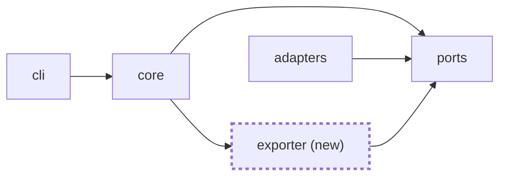

# PR description

Every PR uses this template, whatever the repo. The headings are the ones the
factory's merge request gate requires, so a PR you write by hand and one the
factory opens look the same. If the repo has its own PR template, fill this
template inside it rather than dropping either.

```markdown
## What changed

<one or two sentences>

<one diagram: diff-sketch, call tree, file tree, or Mermaid>

## Why

<ticket key and one sentence, or the problem in one sentence>

## Blast radius

**Door:** <one-way or two-way>. <one sentence on rollback>

**Blast radius:** <one word>. <who or what is affected if this is wrong>

## How verified

**Before:** <output, failing test, or screenshot>

**After:** <the same thing, now right>

## Architecture diff

<Mermaid component graph of the boundaries this touches, changed parts marked>
```

Skip preambles. Keep prose to a sentence or two per section. Use the repo's own
names for things.

## What changed

Pick the smallest view that makes the point. Usually one, at most two.

- Logic: pseudocode, or a `diff` of it.
- Runtime flow: a call tree, or a `diff` of one.
- Files: a shallow tree, or a `diff` of one.

```diff
 src/
 ├── commands/
+│   └── export.ts       # new: parses the export command
 └── sessions/
```

- Interactions between parts: a Mermaid `sequenceDiagram` or `flowchart`.

Show only the files, calls, and states a reviewer needs. Do not list every
changed file; the diff already does.

## How verified

Show a before and an after of the same check, so the reviewer sees the change
working rather than being told it works.

1. A screenshot, when the change is visible and the environment can take one.
2. Command output or a test run: the exact command, trimmed to the lines that matter.
3. A test that failed before and passes now, as pseudocode if it is long.

Name any check that could not run here and why.

## Blast radius

A two-way door is cheap to roll back: revert the commit and nothing is left
behind. A one-way door is not: migrations, deleted data, published APIs,
messages sent. Then say how far a mistake would reach: one module, one repo,
every consumer, every repo.

## Architecture diff

One Mermaid `flowchart` of the components (top-level modules, services, or
packages) this change touches and their dependencies. Mark what is new or
changed and leave the rest plain, so the shape of the change is visible at a
glance:



Keep it under about ten nodes. If the change touches no boundaries, say so in
one line instead of drawing.
