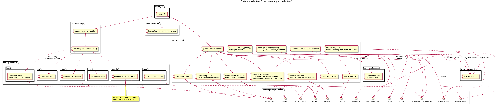
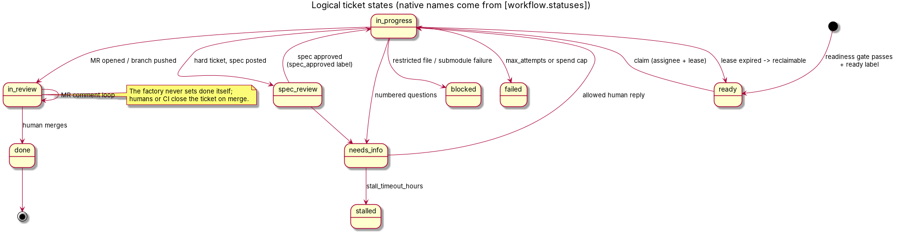
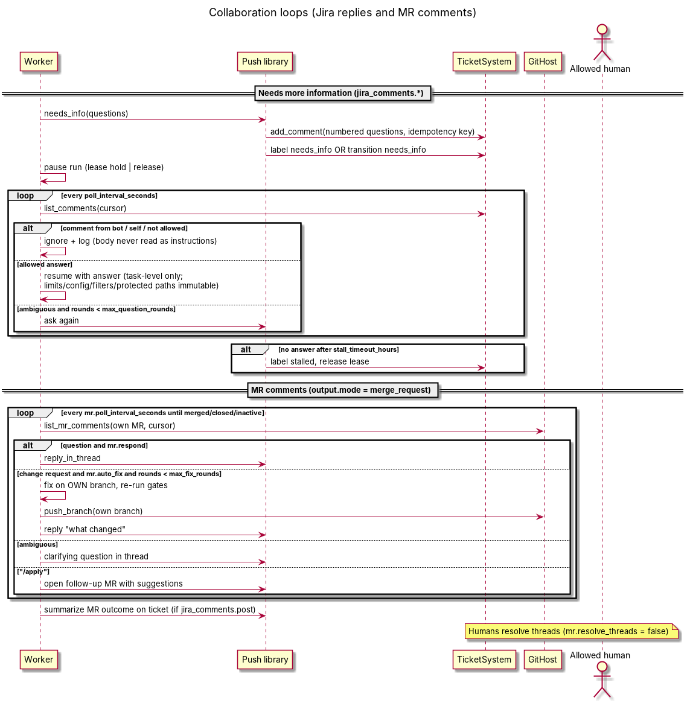

# software-factory

A shared system that turns Jira tickets tagged as ready into verified, human-reviewed merge requests. AI workers claim tickets, implement them in a sandbox, pass mechanical gates, and hand the result to people. The AI never merges.

Everything here is built and tested against simulators. No real Jira, GitLab, mail server, model endpoint, or S3 has been contacted. Going live is a config-only change; see [design/GO_LIVE.md](design/GO_LIVE.md).

## How it flows


Every external write goes through one write library, which supports dry-run. Every model call goes through one budgeted path. Every file an agent sees has already passed the access policy, which mechanically enforces the mandatory "no proprietary files" base skill.

## Architecture

The core depends only on ports (Python `Protocol`s). Each external system is an adapter selected by config, and each has a first-class fake used in tests.




## Ticket states

The factory moves tickets between fixed logical states. `[workflow.statuses]` in config maps each one to your Jira status name.



## Working with people

The agent works with people through Jira comments (questions, answers, a stall timeout) and MR comments (replies, fixes on its own branch, clarifying questions, `/apply`). Both channels are optional and can be toggled separately.



## Agents do the work: Claude Code, Codex, Cline

The factory has no tool loop of its own. A CLI agent does each implementation: `claude`, `codex` or `cline`, launched directly or through `jam` (`jam-claude`, `jam-codex`). Any other CLI can be wrapped with `harness.command`. You pick the harness per stage and per agent; the default is `claude`.

- **Models:** declare any number of providers under `[models.providers.<name>]`, then pick a provider and model per stage. A different provider for review avoids correlated blind spots.
- **What every agent gets:** an isolated workspace (restricted files removed, git history replaced), a task prompt, and a loopback model gateway with a per-run token. An agent never gets upstream credentials.
- **What the factory does itself:** diffs the result, runs the gates, and pushes.

**Rules and skills, delivered each agent's own way** (`[skills].delivery = "native"`, the default):

| Agent | Factory rules | Stage skills |
|---|---|---|
| Claude Code | `~/.claude/CLAUDE.md` | `~/.claude/skills/<name>/SKILL.md` |
| Codex | `~/.codex/AGENTS.md` | `~/.codex/skills/<name>/SKILL.md` |
| Cline | `~/Documents/Cline/Rules/software-factory.md` | inline in the prompt |

- `~` is the sandbox home, outside the repository copy, so nothing lands in the diff. The repo's own `AGENTS.md` or `CLAUDE.md` is still read from the workspace, as usual.
- The prompt names the skills to load and asks for them all in the first turn, one batch.
- The mandatory base skills are also repeated in the prompt: tokens are cheap, and they must not be missed.
- `delivery = "inline"` puts everything in the prompt instead, which saves even the skill-loading turn.

## Requests are the budget

The deployment is assumed to be limited by **requests per hour**, not tokens, so the factory optimizes for fewer round trips:

- **A mandatory base skill** (`factory/skills/base/environment.md`) tells every agent to batch tool calls, read each file once, make complete edits, and stop when done.
- **Sub-agents.** When `[capabilities] subagents = false` (the default), it forbids sub-agents. Claude Code is also started with `--disallowedTools Task`.
- **Per-ticket cap.** `limits.max_requests_per_ticket` fails a ticket that runs away.
- **Hourly window.** `models.budgets.requests_per_hour` throttles every model request through the factory: calls wait for room up to `max_wait_seconds`. A ticket that still can't get room is deferred (released and returned to ready), not failed.
- **Metrics.** `factory metrics` reports requests per ticket.

## Capabilities: one skill text, rendered per environment

`[capabilities]` (`subagents`, `internet`, overridable per agent) decides how the rules and skills read. Any skill or rule file can contain conditional blocks:

```markdown
<!-- factory:if subagents -->
Spawn two sub-agents in parallel...
<!-- factory:else -->
Do both passes yourself, one after the other...
<!-- factory:end -->
```

- Blocks also accept `not` (for example `<!-- factory:if not internet -->`).
- The markers are HTML comments, so the files read normally anywhere else. Unknown capabilities and unbalanced markers are errors.
- **Single file:** a skill folder's `factory.toml` can require a capability for the whole skill or for one reference file.
- **Whole pack:** packs that only make sense online live in `factory/skills/vendor-online/` and load only when `internet = true`.

## Stage skills (HumanLayer and Matt Pocock)

The factory vendors skills from [mattpocock/skills](https://github.com/mattpocock/skills) (MIT) and HumanLayer's Research-Plan-Implement skills from [humanlayer/humanlayer](https://github.com/humanlayer/humanlayer) (Apache-2.0, with its NOTICE), pinned in `factory/skills/vendor/SOURCES.toml`.

**What was rewritten.** Passages that need sub-agents or the internet are wrapped in conditional blocks with single-session and offline alternatives:
- `create-research` and `implement-plan` (HumanLayer);
- `code-review`, `codebase-design` and `improve-codebase-architecture` (Matt Pocock).

Each modified file carries a notice. Matt's `software-factory` vocabulary moved to `vendor-online/`, because its references are web surveys.

`[skills.stages]` maps skills to factory stages; agents can override it under `[overrides.skills]`. These are the defaults:

| Stage | Skills |
|---|---|
| spec (hard tickets) | `mattpocock/to-spec`, `humanlayer-rpi/create-plan`, `mattpocock/codebase-design` |
| implement (and review fixes) | `mattpocock/tdd`, plus `mattpocock/diagnosing-bugs` for Bugs, plus `humanlayer-rpi/create-research` and `humanlayer-rpi/implement-plan` once a spec is approved |
| review | `mattpocock/code-review`, `mattpocock/pr` |
| self-improvement | `mattpocock/retro`, `mattpocock/improve-codebase-architecture` |

**Adapter preamble** (`factory/skills/adapter.md`): adapts the interactive skills to headless runs. Questions become needs-info, working notes go outside the repo, and the factory performs every external action itself. Your own skill packs can be added with `skills.extra_paths`.

## Quick start (simulation)

```sh
pip install -e '.[dev]'
python3 -m pytest -q                       # full suite, network guard on
factory config validate                    # sim profile (default)
factory features --agent docs-bot          # feature state and where each value came from
factory agents                             # agent filters and overlaps
factory scenario run tests/scenarios/cases/happy_path.toml
factory config validate --profile prod     # the go-live checklist: every value still empty
```

Other commands:
- `factory run --agent NAME | --all-agents [--loop]`
- `factory intake [--loop]`
- `factory metrics [--format prometheus]`
- `factory grade [--calibrate labels.jsonl]`
- `factory improve`

Common options: `--profile`, `--enable/--disable FEATURE`, `--set key=value`, `--dry-run`, `--output-mode`.

## Layout

```
factory/
  ports/       interfaces and value types (core depends only on these)
  core/        pipeline, claim, readiness, gates, gateway, harnesses, intake, collaboration, feedback
  access/      access policy guard (no proprietary files)
  config/      schema, layered loader, validation, plugin registry
  features/    feature-toggle table and resolver
  adapters/    fake/ (simulators), jira/, gitlab/, mail/, models/, trace/, sandbox/
  skills/      base skills (mandatory) and the shared readiness checklist
  cli/         the `factory` command
config/        base.toml, profiles/{sim,staging,prod}.toml, agents/*.toml
tests/         scenarios/ (declarative end-to-end), contracts/ (shared port suites), unit/, design/
design/        diagrams (.puml and img/), phase reports, GO_LIVE.md
```

## Documents

- [design/README.md](design/README.md): an index of the design documents and diagrams
- [design/GO_LIVE.md](design/GO_LIVE.md): exactly what to fill in to go live
- [TODO.md](TODO.md): what is left
- Phase reports: [0](design/PHASE0_REPORT.md), [1](design/PHASE1_REPORT.md), [2](design/PHASE2_REPORT.md), [3](design/PHASE3_REPORT.md), [4](design/PHASE4_REPORT.md), [5](design/PHASE5_REPORT.md)
