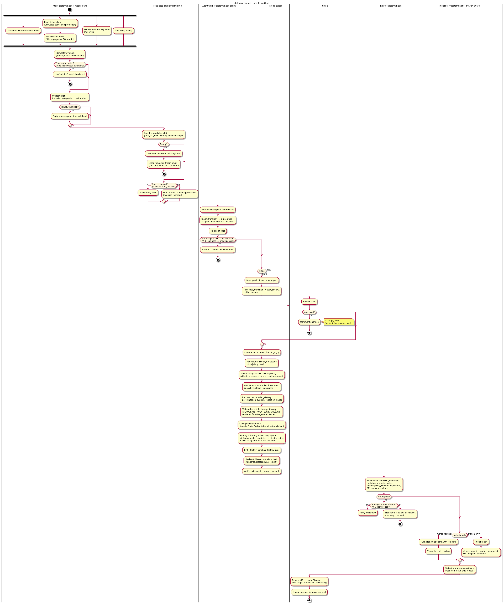
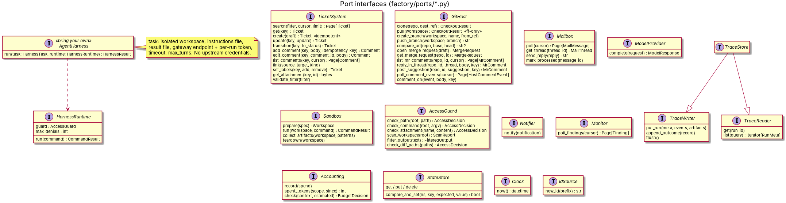

# software-factory

A shared system that turns Jira tickets tagged as ready into verified, human-reviewed merge requests. AI workers claim tickets, implement them in a sandbox, pass mechanical gates, and hand the result to people. The AI never merges.

Everything here is built and tested against simulators. No real Jira, GitLab, mail server, model endpoint, or S3 has been contacted. Going live is a config-only change; see [design/GO_LIVE.md](design/GO_LIVE.md).

## How it flows



Every external write goes through one write library, which supports dry-run. Every model call goes through one budgeted path. Every file an agent sees has already passed the access policy, which mechanically enforces the mandatory "no proprietary files" base skill.

## Architecture

The core depends only on ports (Python `Protocol`s). Each external system is an adapter selected by config, and each has a first-class fake used in tests.




## Ticket states

The factory moves tickets between fixed logical states. `[workflow.statuses]` in config maps each one to your Jira status name.


## Working with people

The agent works with people through Jira comments (questions, answers, a stall timeout) and MR comments (replies, fixes on its own branch, clarifying questions, `/apply`). Both channels are optional and can be toggled separately.


## Bring your own harness and model

- **Models:** declare any number of providers under `[models.providers.<name>]`, then pick a provider and model per stage. A different provider for review avoids correlated blind spots.
- **Harnesses:** pick one per stage and per agent. The options are:
  - `builtin`: the in-house tool loop, where every tool call goes through the access guard;
  - `claude`, `codex`, `cline`, `jam-claude`, `jam-codex`: CLI agents launched directly or through `jam`;
  - `harness.command`: any other CLI agent.
- **What every harness gets:** an isolated workspace (restricted files removed, git history replaced) and a loopback model gateway with a per-run token. A harness never gets upstream credentials.
- **What the factory does itself:** diffs the result, runs the gates, and pushes.

## Stage skills (HumanLayer and Matt Pocock)

The factory vendors third-party skills **unmodified**, with their licenses and the pinned source commit, in `factory/skills/vendor/` (see `SOURCES.toml`):
- [mattpocock/skills](https://github.com/mattpocock/skills) (MIT);
- HumanLayer's Research-Plan-Implement skills from [humanlayer/humanlayer](https://github.com/humanlayer/humanlayer) (Apache-2.0, with its NOTICE).

`[skills.stages]` in config maps them to factory stages, and agents can override that under `[overrides.skills]`. These are the defaults:

| Stage | Skills |
|---|---|
| spec (hard tickets) | `mattpocock/to-spec`, `humanlayer-rpi/create-plan`, `mattpocock/codebase-design` |
| implement (and review fixes) | `mattpocock/tdd`, plus `mattpocock/diagnosing-bugs` for Bugs, plus `humanlayer-rpi/create-research` and `humanlayer-rpi/implement-plan` once a spec is approved |
| review | `mattpocock/code-review`, `mattpocock/pr` |
| self-improvement | `mattpocock/retro`, `mattpocock/improve-codebase-architecture` |

**How they're delivered:**
- **Inline:** the selected skills, including their reference files, are rendered into each stage's instructions after the mandatory base skills. The base skills always win.
- **Native:** for Claude Code and Codex, the skills are also installed into the sandbox's `~/.claude/skills` and `~/.codex/skills`, outside the repository copy.
- **Adapter preamble** (`factory/skills/adapter.md`): adapts the interactive skills to headless runs. Questions become needs-info, working notes go outside the repo, and the factory performs every external action itself.

`humanlayer-rpi/create-research-questions` and `mattpocock/software-factory` (Matt's design vocabulary for factories) are vendored but not mapped to a stage by default. Your own skill packs can be added with `skills.extra_paths`.

## Quick start (simulation)

```sh
pip install -e '.[dev]'
python3 -m pytest -q                       # full suite, network guard on
factory config validate                    # sim profile (default)
factory features --agent docs-bot          # feature state and where each value came from
factory agents                             # agent filters and overlaps
factory scenario run tests/scenarios/cases/happy_path.toml
factory config validate --profile prod     # the go-live checklist: every value still empty
```

Other commands:
- `factory run --agent NAME | --all-agents [--loop]`
- `factory intake [--loop]`
- `factory metrics [--format prometheus]`
- `factory grade [--calibrate labels.jsonl]`
- `factory improve`

Common options: `--profile`, `--enable/--disable FEATURE`, `--set key=value`, `--dry-run`, `--output-mode`.

## Layout

```
factory/
  ports/       interfaces and value types (core depends only on these)
  core/        pipeline, claim, readiness, gates, gateway, harnesses, intake, collaboration, feedback
  access/      access policy guard (no proprietary files)
  config/      schema, layered loader, validation, plugin registry
  features/    feature-toggle table and resolver
  adapters/    fake/ (simulators), jira/, gitlab/, mail/, models/, trace/, sandbox/
  skills/      base skills (mandatory) and the shared readiness checklist
  cli/         the `factory` command
config/        base.toml, profiles/{sim,staging,prod}.toml, agents/*.toml
tests/         scenarios/ (declarative end-to-end), contracts/ (shared port suites), unit/, design/
design/        diagrams (.puml and img/), phase reports, GO_LIVE.md
```

## Documents

- [design/README.md](design/README.md): an index of the design documents and diagrams
- [design/GO_LIVE.md](design/GO_LIVE.md): exactly what to fill in to go live
- [TODO.md](TODO.md): what is left
- Phase reports: [0](design/PHASE0_REPORT.md), [1](design/PHASE1_REPORT.md), [2](design/PHASE2_REPORT.md), [3](design/PHASE3_REPORT.md), [4](design/PHASE4_REPORT.md), [5](design/PHASE5_REPORT.md)
