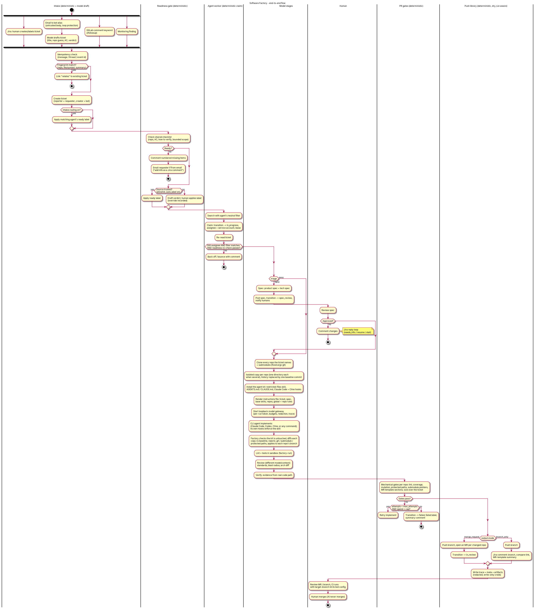
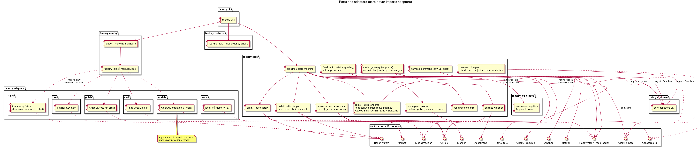
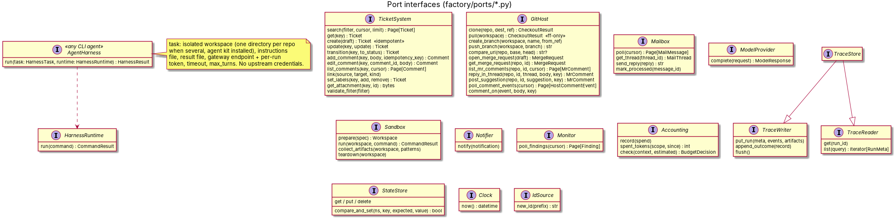
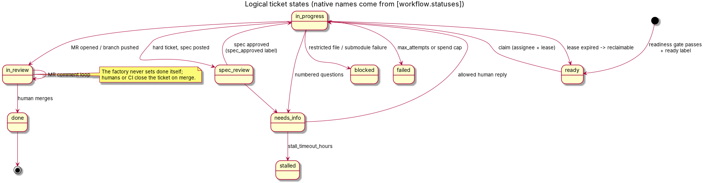
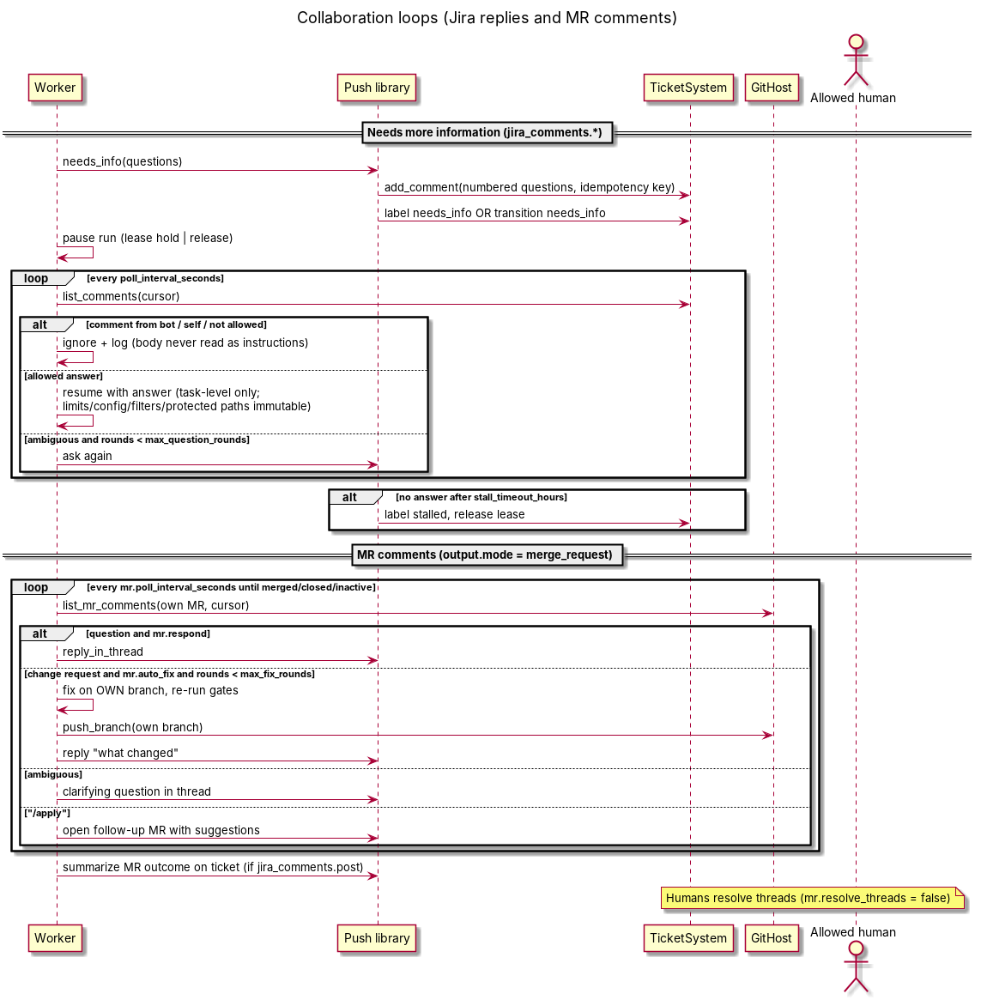

# Design

The diagrams are PlantUML sources (`*.puml`), with rendered PNGs in `img/`. To re-render after editing a source:

```sh
plantuml -tpng -o img design/*.puml
```

## End-to-end flow ([flow.puml](flow.puml))



## Ports and adapters ([components.puml](components.puml))



## Port interfaces ([ports.puml](ports.puml))



## Logical ticket states ([workflow-states.puml](workflow-states.puml))



## Collaboration loops ([collaboration.puml](collaboration.puml))



## Documents

| Document | Contents |
|---|---|
| [PHASE0_REPORT.md](PHASE0_REPORT.md) | Design decisions, the feature table, the Jira mapping format, the open questions |
| [PHASE1_REPORT.md](PHASE1_REPORT.md) | The core on fakes and the CLI-agent harnesses (Claude Code, Codex, Cline and jam) |
| [PHASE2_REPORT.md](PHASE2_REPORT.md) | The Jira reply loop, the MR comment loop, reviewer suggestions, the coverage and mutation gates |
| [PHASE3_REPORT.md](PHASE3_REPORT.md) | Email and GitLab-comment intake, draft-only mode, override tracking |
| [PHASE4_REPORT.md](PHASE4_REPORT.md) | Monitoring, metrics, S3 traces, grading, self-improvement |
| [PHASE5_REPORT.md](PHASE5_REPORT.md) | Real adapters tested against fixtures |
| [GO_LIVE.md](GO_LIVE.md) | The config keys and secrets to fill in, and the infrastructure checklist |
| [AGENT_KIT.md](AGENT_KIT.md) | Restricted files (the agent kit: skill, hooks, deny rules), multi-repo tickets, and local workspaces |

The phase reports record how the system was built. Where they differ from the
code, the code, the top-level README and AGENT_KIT.md are current: the
factory-side file policy and the in-process tool-loop harness they describe
were replaced by the agent kit and CLI-agent harnesses.
